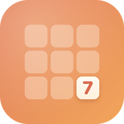
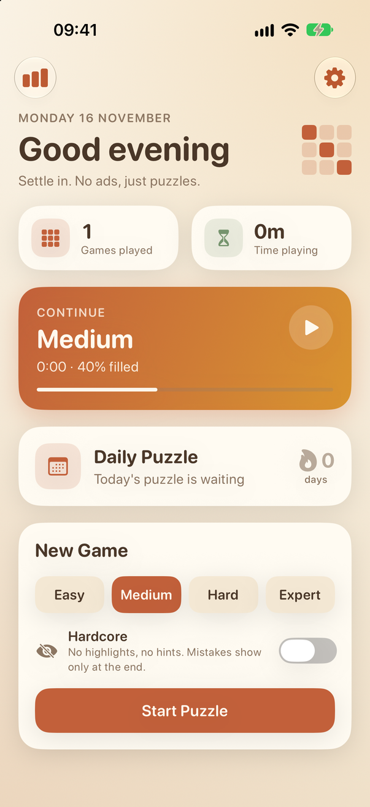
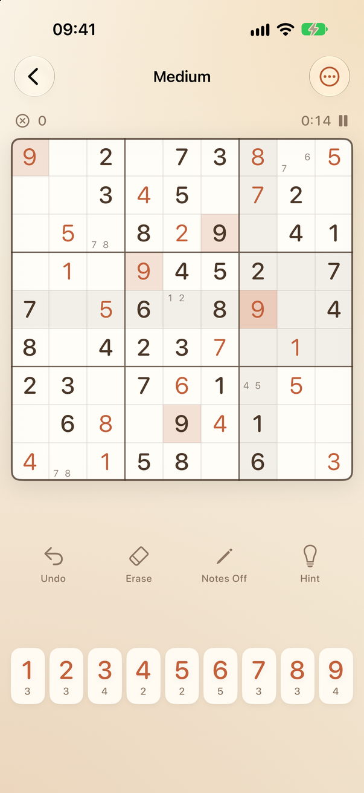
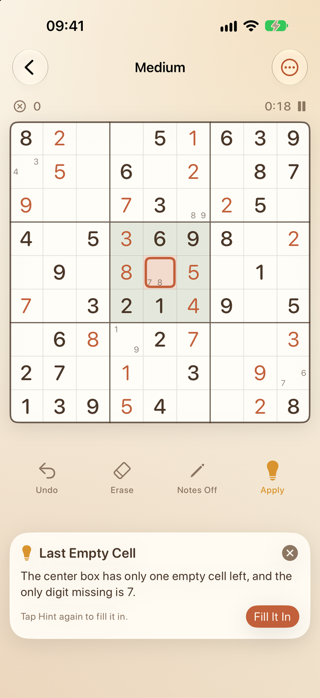
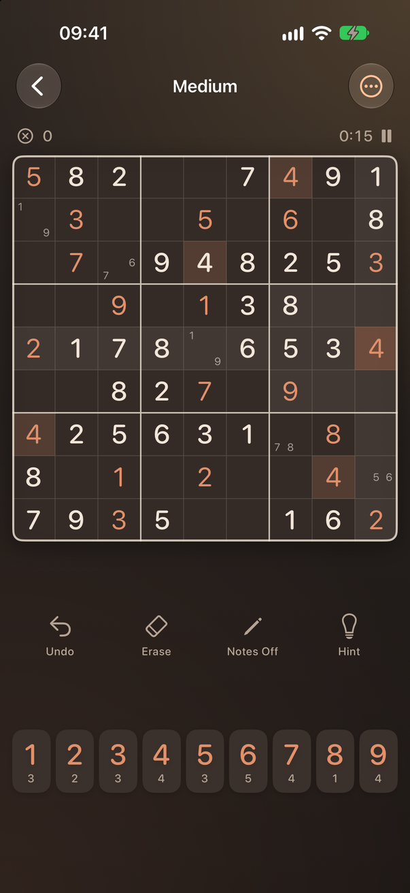

<p align="center">
  
</p>

# SudokuH

A homemade Sudoku app for iOS. No ads, no tracking, no internet connection.

<p align="center">
  
  
  
  
</p>

## Why I built it

I couldn't stand the ads in the Sudoku app I was using, so I made my own.
Built entirely with [Claude Code](https://claude.com/claude-code).

## Features

- **Four difficulty levels**: Easy, Medium, Hard and Expert. Every puzzle has exactly one solution.
- **Daily puzzle** with a streak counter. It sits next to your regular game, so playing one never discards the other.
- **Smart hints** that name the technique and explain why the digit goes there, before filling it in.
- **Notes**, undo and erase.
- **Hardcore mode**: no highlights, no hints, and mistakes are only revealed once the board is full.
- **Optional mistake limit**: three mistakes and the game is over.
- **Statistics**: games played, time played, best times and history, with export and import.
- **Four warm themes**: Cozy Cream, Sage Garden, Fireplace and Midnight Cocoa. Automatic follows the system's light or dark appearance.
- **Comfort settings**: large digits, optional timer, haptics and tap sounds.
- **iPhone and iPad**, with a side-by-side layout on iPad in landscape.

## How to run it

Requires Xcode and iOS 17 or later.

1. Clone the repo and open `SudokuH.xcodeproj` in Xcode.
2. Pick an iPhone simulator (or your own device).
3. Press Cmd+R to build and run. Cmd+U runs the tests.

## App icon

The icon (light, dark and tinted) is generated by a script, so the colours are easy to change.
Edit the palette at the top of `Design/make_icon.swift`, then run:

```
swift Design/make_icon.swift
```
